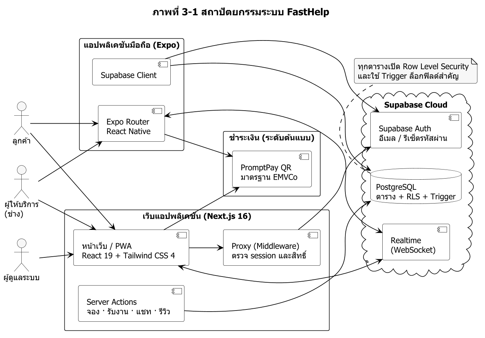
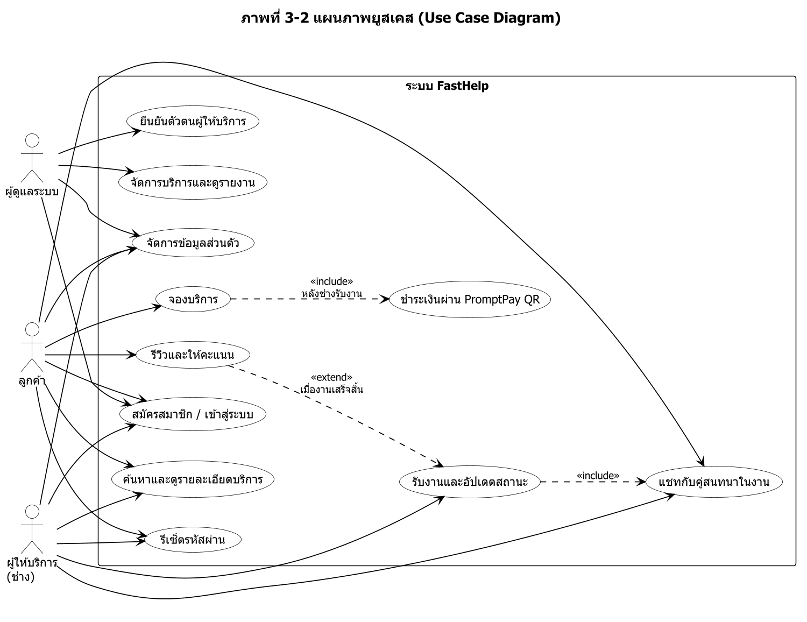
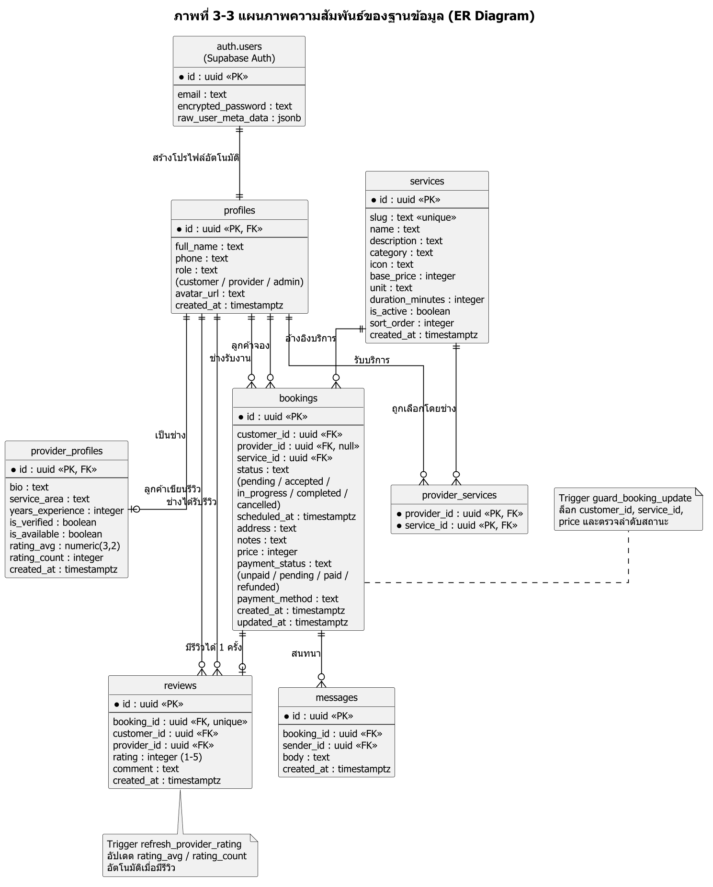
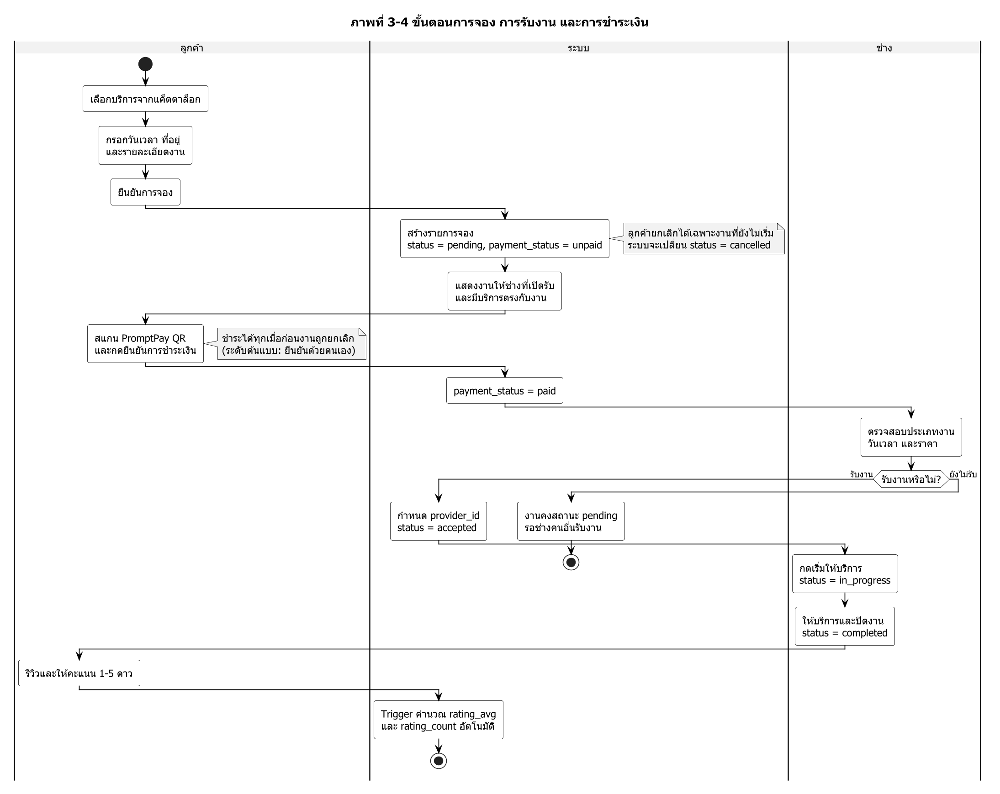
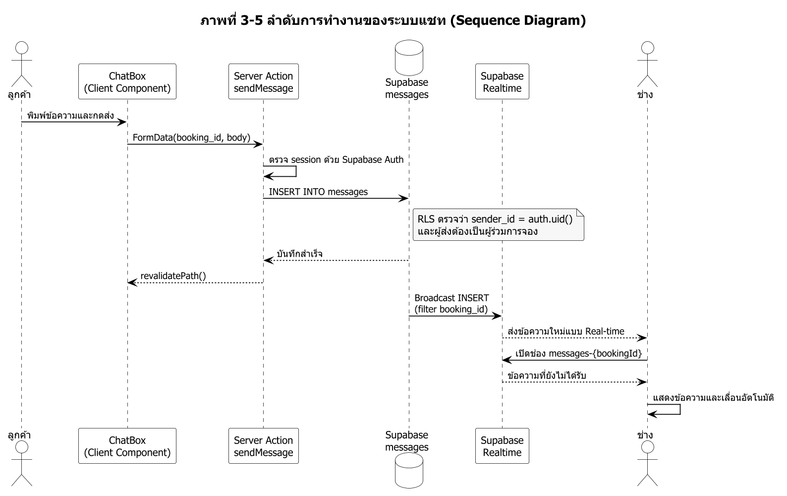
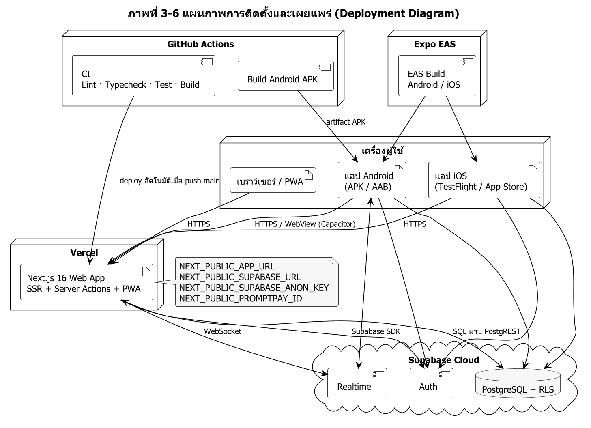

# รายงานโครงงาน FastHelp

**แพลตฟอร์มเรียกช่างและบริการถึงบ้าน**

> เอกสารนี้สร้างจาก `docs/build_report.py` — ไดอะแกรมต้นฉบับอยู่ใน `docs/diagrams/`

---

# บทคัดย่อ

รายงานฉบับนี้นำเสนอการออกแบบและพัฒนาระบบ FastHelp ซึ่งเป็นแพลตฟอร์มดิจิทัลสำหรับการเรียกช่าง และบริการถึงบ้าน โดยเชื่อมโยงลูกค้าที่ต้องการใช้บริการเข้ากับผู้ให้บริการหรือช่างที่มีทักษะตรงกับงาน ปัญหาหลักที่โครงงานนี้มุ่งแก้ไขคือการค้นหาช่างที่เชื่อถือได้ทำได้ยาก ราคาและรายละเอียดบริการไม่ชัดเจน การนัดหมายและการติดตามสถานะเป็นเรื่องที่ต้องสื่อสารหลายช่องทาง และผู้ใช้ขาดข้อมูลประกอบการตัดสินใจ เช่น ประวัติการให้บริการและคะแนนรีวิว

ระบบถูกพัฒนาขึ้นในรูปแบบเว็บแอปพลิเคชันด้วย Next.js 16 (App Router) ร่วมกับ React 19 และ Tailwind CSS 4 โดยใช้ Supabase เป็นฐานข้อมูล PostgreSQL พร้อมระบบยืนยันตัวตน Realtime และ Row Level Security (RLS) นอกจากนี้ยังมีแอปพลิเคชันมือถือที่พัฒนาเพิ่มเติมด้วย Expo และ React Native ซึ่งใช้ฐานข้อมูลชุดเดียวกับเว็บ ทำให้ข้อมูลบริการ การจอง โปรไฟล์ช่าง และข้อความแชทถูกแบ่งปันระหว่างสองแพลตฟอร์มได้ทันที

ฟังก์ชันหลักประกอบด้วยการสมัครสมาชิกและเข้าสู่ระบบด้วยอีเมล การค้นหาและจองบริการ การเลือกวันเวลา ที่อยู่ และพิกัดจุดนัดหมาย การรับงานและอัปเดตสถานะของช่าง การแชทแบบเรียลไทม์ที่รองรับข้อความ รูปภาพ การแชร์ตำแหน่ง สถานะการพิมพ์ และการยืนยันการอ่าน การชำระเงินผ่าน PromptPay QR ในระดับต้นแบบ การรีวิวและให้คะแนน ตลอดจนแดชบอร์ดสำหรับผู้ให้บริการและผู้ดูแลระบบ ด้านความปลอดภัย ระบบใช้ RLS ทุกตารางและนโยบาย Storage สำหรับรูปภาพแชท ร่วมกับ Trigger เพื่อป้องกันการเปลี่ยนบทบาทของผู้ใช้ การแก้ไขราคาและข้อมูลสำคัญของการจอง และการเปลี่ยนลำดับสถานะที่ไม่ถูกต้อง

ผลการตรวจสอบคุณภาพโค้ดพบว่าเว็บแอปพลิเคชันผ่านการตรวจสอบด้วย ESLint การตรวจชนิดข้อมูลด้วย TypeScript การทดสอบหน่วย 17 กรณีจาก 4 ไฟล์ และการสร้างโปรดักชันบิลด์สำเร็จ 22 รายการเส้นทาง ส่วนแอปพลิเคชันมือถือผ่านทั้งการตรวจรูปแบบโค้ด ด้วย ESLint และการตรวจชนิดข้อมูลด้วย TypeScript โดยทั้งสองส่วนถูกรวมไว้ในกระบวนการ CI อย่างไรก็ตาม Next.js แจ้งคำแนะนำด้านความปลอดภัยระหว่างการ build จึงควรอัปเกรดและทดสอบซ้ำก่อนเผยแพร่ นอกจากนี้ยังมีงานที่ต้องดำเนินการก่อนเผยแพร่จริง เช่น การลงชื่อแอปด้วย keystore สำหรับโปรดักชัน การสร้างไฟล์ App Bundle การผูกโปรเจกต์กับ EAS การเตรียมข้อมูลร้านค้า และการกำหนดชื่อโดเมนจริง

คำสำคัญ: แพลตฟอร์มบริการถึงบ้าน, Next.js, Supabase, Row Level Security, Realtime, Expo, PromptPay


---

# สารบัญ

*สารบัญ: ดูได้จากไฟล์ Word (.docx) ซึ่งมีสารบัญแบบอัปเดตอัตโนมัติ*


---

# บทที่ 1 บทนำ

## 1.1 ความเป็นมาและความสำคัญของโครงงาน

การเรียกช่างเพื่อซ่อมแซมหรือให้บริการถึงบ้านเป็นความต้องการที่เกิดขึ้นเป็นประจำในชีวิตประจำวัน เช่น การล้างแอร์ การทำความสะอาดบ้าน การเปลี่ยนแบตเตอรี่รถยนต์ การซ่อมระบบไฟฟ้า และการซ่อมท่อน้ำ ในปัจจุบันผู้ใช้จำนวนมากยังต้องค้นหาผู้ให้บริการผ่านสื่อสังคมออนไลน์ การบอกต่อ หรือการโทรสอบถามหลายราย ซึ่งทำให้เสียเวลาและยากต่อการเปรียบเทียบราคาและคุณภาพ

นอกจากนี้ ผู้ใช้ยังขาดข้อมูลที่ช่วยสร้างความมั่นใจ เช่น ประวัติการให้บริการ พื้นที่ให้บริการ และคะแนนรีวิวจากลูกค้ารายก่อน ขณะเดียวกันช่างอิสระก็ประสบปัญหาในการเข้าถึงลูกค้าใหม่และการจัดการคิวงานอย่างเป็นระบบ การสื่อสารเรื่องวันเวลา ราคา และสถานะงานมักกระจัดกระจายอยู่หลายช่องทาง ทำให้เกิดความคลาดเคลื่อนและข้อร้องเรียน

โครงงาน FastHelp จึงถูกพัฒนาขึ้นเพื่อเป็นตัวกลางในการจองและบริหารจัดการงานบริการถึงบ้านอย่างเป็นระบบ ผู้ใช้สามารถค้นหาบริการ ดูราคาเริ่มต้น จองคิว เลือกวันเวลาและสถานที่ ชำระเงิน ติดตามสถานะ แชทกับช่าง และให้คะแนนหลังได้รับบริการ ในขณะที่ช่างสามารถกำหนดบริการที่รับ พื้นที่ให้บริการ และสถานะการรับงาน ตลอดจนอัปเดตความคืบหน้าของงานได้ด้วยตนเอง

## 1.2 วัตถุประสงค์ของโครงงาน

1. เพื่อออกแบบและพัฒนาแพลตฟอร์มกลางสำหรับการเรียกช่างและบริการถึงบ้านที่ใช้งานได้ทั้งเว็บและมือถือ
2. เพื่อลดขั้นตอนและเวลาที่ใช้ในการค้นหาผู้ให้บริการ เปรียบเทียบราคา และจองบริการ
3. เพื่อให้ผู้ให้บริการสามารถจัดการงาน รับงาน และอัปเดตสถานะได้อย่างเป็นระบบ
4. เพื่อยกระดับความน่าเชื่อถือของบริการผ่านระบบยืนยันตัวตน คะแนนรีวิว และการติดตามสถานะ
5. เพื่อประยุกต์ใช้เทคโนโลยีเว็บสมัยใหม่ ฐานข้อมูลคลาวด์ และมาตรการความปลอดภัยระดับแถวในการพัฒนาโครงงาน

## 1.3 ขอบเขตของโครงงาน

โครงงานนี้ครอบคลุมความสามารถหลักดังต่อไปนี้

- ระบบสมัครสมาชิกและเข้าสู่ระบบด้วยอีเมลผ่าน Supabase Auth พร้อมการแยกบทบาทลูกค้า ผู้ให้บริการ และผู้ดูแลระบบ
- ระบบรีเซ็ตรหัสผ่านผ่านลิงก์อีเมล
- แค็ตตาล็อกบริการ 10 รายการ ใน 7 หมวดหมู่ พร้อมหน้าแสดงรายละเอียด ราคาเริ่มต้น หน่วย และระยะเวลาดำเนินงาน
- ระบบจองบริการโดยเลือกวันเวลา ที่อยู่ และรายละเอียดงาน พร้อมตรวจสอบวันเวลาในอนาคต และบันทึกพิกัดจุดนัดหมายได้หากผู้ใช้อนุญาต
- ระบบรับงานของผู้ให้บริการตามประเภทบริการและสถานะพร้อมรับงาน
- ระบบติดตามสถานะงาน ได้แก่ รอรับงาน รับงานแล้ว กำลังให้บริการ เสร็จสิ้น และยกเลิก
- แผนที่จุดนัดหมายและการแชร์พิกัดในแชทผ่าน OpenStreetMap โดยไม่ต้องใช้ API key
- ระบบแชทแบบเรียลไทม์ระหว่างลูกค้าและผู้ให้บริการที่รองรับข้อความ รูปภาพ สถานะการพิมพ์ และสถานะการอ่าน
- การชำระเงินผ่าน PromptPay QR ในระดับต้นแบบ โดยผู้ใช้ยืนยันการชำระด้วยตนเอง
- ระบบรีวิวและให้คะแนนผู้ให้บริการ พร้อมคำนวณคะแนนเฉลี่ยอัตโนมัติ
- แดชบอร์ดผู้ให้บริการและแดชบอร์ดผู้ดูแลระบบสำหรับยืนยันช่างและเปิดหรือปิดบริการ
- เว็บแอปพลิเคชันแบบ Responsive ที่ติดตั้งเป็น PWA ได้
- แอปพลิเคชันมือถือด้วย Expo ที่ใช้ฐานข้อมูลชุดเดียวกับเว็บ

ส่วนต่อไปนี้อยู่นอกขอบเขตของโครงงานในเวอร์ชันปัจจุบัน

- การเชื่อมต่อ Payment Gateway จริงและการกระทบยอดอัตโนมัติ (ปัจจุบันเป็นการยืนยันการชำระด้วยตนเอง)
- ระบบคืนเงินอัตโนมัติและใบเสร็จอิเล็กทรอนิกส์
- ระบบแจ้งเตือนแบบ Push Notification
- ระบบจับคู่ผู้ให้บริการตามระยะทางหรือพื้นที่ให้บริการแบบอัตโนมัติ (ปัจจุบันจับคู่ตามประเภทบริการและสถานะพร้อมรับงาน)
- ระบบยืนยันตัวตนด้วยบัตรประชาชนหรือใบประกอบวิชาชีพ (KYC)
- ระบบโปรโมชั่น คูปอง และการตลาด
- รายงานวิเคราะห์เชิงธุรกิจขั้นสูง

## 1.4 ประโยชน์ที่คาดว่าจะได้รับ

- ลูกค้า: เข้าถึงบริการได้ง่ายขึ้น เห็นราคาและรายละเอียดล่วงหน้า สามารถจองและติดตามงานได้ในที่เดียว
- ผู้ให้บริการ: มีช่องทางรับงานใหม่ จัดการคิวและสถานะงานได้เป็นระบบ และสร้างความน่าเชื่อถือผ่านโปรไฟล์และรีวิว
- ผู้ดูแลระบบ: มีเครื่องมือยืนยันผู้ให้บริการ ควบคุมบริการที่เปิดใช้งาน และติดตามภาพรวมการจอง
- ผู้พัฒนาและผู้ศึกษา: ได้แนวทางปฏิบัติในการพัฒนาเต็มสแตกด้วย Next.js, Supabase, Expo และ RLS พร้อมกระบวนการ CI/CD

## 1.5 นิยามศัพท์

- ลูกค้า (Customer) หมายถึง ผู้ใช้ที่ค้นหาและจองบริการ
- ผู้ให้บริการ (Provider) หมายถึง ช่างหรือผู้ประกอบการที่รับงานและให้บริการ
- ผู้ดูแลระบบ (Admin) หมายถึง ผู้มีสิทธิ์ยืนยันผู้ให้บริการและจัดการแค็ตตาล็อก
- การจอง (Booking) หมายถึง รายการงานที่ลูกค้าสร้างขึ้น โดยระบุบริการ วันเวลา ที่อยู่ และราคา
- RLS (Row Level Security) หมายถึง กลไกของ PostgreSQL ที่จำกัดการเข้าถึงข้อมูลในระดับแถวตามสิทธิ์ของผู้ใช้
- Realtime หมายถึง การส่งข้อมูลระหว่างเซิร์ฟเวอร์และไคลเอนต์ทันทีที่มีการเปลี่ยนแปลง โดยไม่ต้องรีเฟรชหน้า
- PWA (Progressive Web App) หมายถึง เว็บแอปพลิเคชันที่ติดตั้งบนอุปกรณ์และทำงานได้ใกล้เคียงแอปเนทีฟ
- PromptPay QR หมายถึง รหัสคิวอาร์สำหรับรับเงินผ่านระบบพร้อมเพย์ ซึ่งอ้างอิงมาตรฐาน EMVCo


---

# บทที่ 2 ทฤษฎีและเทคโนโลยีที่เกี่ยวข้อง

## 2.1 Next.js 16 และสถาปัตยกรรม App Router

Next.js เป็นเฟรมเวิร์กสำหรับสร้างเว็บแอปพลิเคชันบน React ที่รองรับการเรนเดอร์ฝั่งเซิร์ฟเวอร์ (SSR) การสร้างหน้าแบบคงที่ (SSG) และการเรนเดอร์ฝั่งไคลเอนต์ โครงงานนี้ใช้ Next.js 16 ร่วมกับ App Router ซึ่งจัดโครงสร้างหน้าตามโฟลเดอร์ภายใต้ src/app และรองรับ React Server Components ทำให้สามารถดึงข้อมูลจากฐานข้อมูล บนเซิร์ฟเวอร์และส่งเฉพาะข้อมูลที่จำเป็นไปยังเบราว์เซอร์

นอกจากนี้ยังใช้ Server Actions สำหรับจัดการฟอร์มและการเปลี่ยนแปลงข้อมูล เช่น การจอง การรับงาน การอัปเดตสถานะ การส่งข้อความ และการยืนยันการชำระเงิน ทำให้ลดความจำเป็นในการสร้าง API route แยกต่างหาก และใช้ Proxy (Middleware) ในการตรวจสอบ session ก่อนเข้าถึงเส้นทางที่ต้องเข้าสู่ระบบ

## 2.2 React 19 และ Tailwind CSS 4

React 19 เป็นไลบรารีสำหรับสร้างส่วนติดต่อผู้ใช้แบบองค์ประกอบ (Component) โครงงานใช้ความสามารถของ Client Components สำหรับส่วนที่ต้องโต้ตอบ เช่น ฟอร์มจอง ช่องแชท และการสมัครสมาชิก ส่วนงานนำเสนอใช้ Tailwind CSS 4 ซึ่งเป็นยูทิลิตีคลาสที่ช่วยให้กำหนดรูปแบบได้อย่างรวดเร็วและสอดคล้องกัน พร้อมรองรับการออกแบบ responsive สำหรับเดสก์ท็อป แท็บเล็ต และโทรศัพท์มือถือ

## 2.3 Supabase และ PostgreSQL

Supabase เป็นแพลตฟอร์ม Backend-as-a-Service ที่ให้บริการฐานข้อมูล PostgreSQL ระบบยืนยันตัวตน API อัตโนมัติ (PostgREST) ระบบจัดเก็บไฟล์ และ Realtime ผ่าน WebSocket โครงงานใช้ Supabase เป็นศูนย์กลาง ของข้อมูลทั้งหมด โดยเว็บและแอปมือถือเชื่อมต่อโปรเจกต์เดียวกัน

จุดเด่นที่สำคัญคือ Row Level Security (RLS) ซึ่งช่วยกำหนดว่าผู้ใช้แต่ละคนสามารถอ่านหรือเขียนแถวใดได้บ้าง โดยตรวจสอบจาก auth.uid() ที่ Supabase Auth สร้างให้ ทำให้แม้ไคลเอนต์จะเรียก API โดยตรง ก็ไม่สามารถเข้าถึงข้อมูลของผู้ใช้อื่นได้หากไม่มีสิทธิ์

นอกจาก RLS แล้ว โครงงานยังใช้ Trigger ของ PostgreSQL เพื่อบังคับกฎทางธุรกิจ เช่น การสร้างโปรไฟล์อัตโนมัติเมื่อสมัครสมาชิก การป้องกันการเปลี่ยนบทบาทของตนเอง การล็อกฟิลด์ราคาและเจ้าของงาน และการคำนวณคะแนนเฉลี่ยเมื่อมีรีวิวใหม่

สำหรับแชท ระบบใช้ Realtime ทั้งเหตุการณ์ INSERT ของตาราง messages และช่อง broadcast สำหรับสถานะการพิมพ์ ส่วนรูปภาพถูกเก็บใน Supabase Storage bucket ชื่อ chat-images ซึ่งเป็น bucket ส่วนตัว ไฟล์แต่ละไฟล์อยู่ในเส้นทาง {booking_id}/{sender_id}/{uuid}.{ext} และเข้าถึงได้ผ่าน Signed URL ที่มีอายุ 1 ชั่วโมงตามสิทธิ์ของผู้ร่วมงาน

## 2.4 Expo และ React Native

Expo เป็นชุดเครื่องมือสำหรับพัฒนาแอปพลิเคชันมือถือด้วย React Native ซึ่งช่วยให้เขียนโค้ดครั้งเดียวแล้วรันได้ทั้ง Android และ iOS โครงงานใช้ Expo SDK 58 ร่วมกับ Expo Router สำหรับจัดการเส้นทางแบบอิงไฟล์ และใช้ Supabase Client ชุดเดียวกับเว็บ ทำให้ข้อมูลบริการ การจอง และข้อความแชทเป็นข้อมูลชุดเดียวกัน

แอปใช้ expo-location สำหรับอ่านพิกัดตอนจองและตอนแชร์ตำแหน่งในแชท รวมถึง expo-image-picker สำหรับเลือกภาพจากคลัง โดยขออนุญาตเฉพาะตอนผู้ใช้กดใช้งานและกำหนดข้อความอธิบายการใช้สิทธิ์ใน app.json สำหรับทั้ง Android และ iOS

สำหรับการเผยแพร่ แอปสามารถสร้างไฟล์ APK สำหรับทดสอบผ่าน GitHub Actions หรือใช้ EAS Build ในการสร้างไฟล์สำหรับ Google Play และ App Store ในอนาคต

## 2.5 PromptPay QR และมาตรฐาน EMVCo

PromptPay QR เป็นช่องทางรับเงินที่ได้รับความนิยมในประเทศไทย โดยข้อมูลบน QR จะถูกเข้ารหัสตามมาตรฐาน EMVCo ซึ่งประกอบด้วยข้อมูลผู้รับเงิน ประเภทบัญชี และจำนวนเงิน โครงงานนี้สร้าง payload ของ QR ฝั่งไคลเอนต์ เพื่อแสดงภาพ QR ให้ผู้ใช้สแกนด้วยแอปพลิเคชันธนาคาร และให้ผู้ใช้กดยืนยันการชำระเงินด้วยตนเอง เพื่อลดความซับซ้อนและค่าใช้จ่ายในการเชื่อมต่อผู้ให้บริการชำระเงินจริงในระดับต้นแบบ

## 2.6 PWA และ Capacitor

Progressive Web App (PWA) ช่วยให้เว็บแอปพลิเคชันสามารถติดตั้งบนหน้าจอโฮมของอุปกรณ์และทำงานได้ใกล้เคียงแอปเนทีฟ โครงงานมีไฟล์ manifest, service worker, ไอคอน และหน้า offline เพื่อรองรับการติดตั้งและการใช้งานพื้นฐาน นอกจากนี้ยังมีโครงสำหรับห่อเว็บด้วย Capacitor เพื่อสร้างแอป Android และ iOS ที่โหลดเว็บที่เผยแพร่แล้ว

## 2.7 เครื่องมือพัฒนา การทดสอบ และ CI/CD

โครงงานใช้ TypeScript เพื่อตรวจสอบชนิดข้อมูลตั้งแต่ขั้นตอนพัฒนา ใช้ ESLint สำหรับตรวจสอบรูปแบบโค้ด และใช้ Vitest สำหรับทดสอบหน่วยของฟังก์ชันที่สำคัญ เช่น การจัดรูปแบบวันที่และราคา การสร้าง PromptPay payload การตรวจเส้นทางที่ซ่อนแถบนำทาง และการตรวจพิกัด อายุตำแหน่ง รวมถึงลิงก์ OpenStreetMap กระบวนการ CI ถูกกำหนดด้วย GitHub Actions ให้รัน lint, typecheck, test และ build ของเว็บ รวมถึง lint และ typecheck ของแอปมือถือ ทุกครั้งที่มีการ push หรือเปิด pull request ไปยัง branch main

ส่วนการเผยแพร่ใช้ Vercel สำหรับเว็บแอปพลิเคชัน เนื่องจากรองรับ Next.js โดยตรงและสามารถ deploy อัตโนมัติจาก GitHub ขณะที่แอปมือถือใช้ GitHub Actions สำหรับสร้าง APK และใช้ EAS สำหรับ build บนคลาวด์


---

# บทที่ 3 การออกแบบระบบ

## 3.1 ภาพรวมระบบและบทบาทผู้ใช้

FastHelp เป็นระบบที่มีผู้ใช้สามบทบาท แต่ละบทบาทมีสิทธิ์และหน้าที่แตกต่างกันตามที่แสดงในตารางที่ 3-1 ระบบถูกออกแบบให้ใช้ฐานข้อมูลชุดเดียวสำหรับเว็บและแอปมือถือ เพื่อลดความซ้ำซ้อนของข้อมูลและลดต้นทุนการพัฒนา

**ตารางที่ 3-1 บทบาทผู้ใช้และความสามารถหลัก**

| บทบาท | ความสามารถหลัก | เส้นทางหลัก |
| --- | --- | --- |
| ลูกค้า<br>(Customer) | สมัคร/เข้าสู่ระบบ ค้นหาบริการ จองบริการ ติดตามสถานะ ยกเลิกงานที่ยังไม่เริ่ม ชำระเงิน แชท และรีวิว | /, /services, /bookings, /account |
| ผู้ให้บริการ<br>(Provider) | ตั้งค่าโปรไฟล์ พื้นที่ และบริการที่รับ เปิด/ปิดรับงาน ดูงานที่ตรงทักษะ รับงาน อัปเดตสถานะ แชท และดูคะแนน | /provider, /provider/profile, /provider/jobs/[id] |
| ผู้ดูแลระบบ<br>(Admin) | ยืนยันหรือยกเลิกการยืนยันผู้ให้บริการ เปิด/ปิดบริการในแค็ตตาล็อก ดูสถิติและรายการจองล่าสุด | /admin |

## 3.2 สถาปัตยกรรมระบบ

ระบบถูกแบ่งออกเป็นสี่ชั้นหลัก ได้แก่ ชั้นนำเสนอ (Presentation Layer) ชั้นประยุกต์ (Application Layer) ชั้นข้อมูล (Data Layer) และชั้นบริการภายนอก (External Services) ดังแสดงในภาพที่ 3-1



*ภาพที่ 3-1 สถาปัตยกรรมระบบ FastHelp*

ชั้นนำเสนอประกอบด้วยเว็บแอปพลิเคชันที่สร้างด้วย Next.js และแอปพลิเคชันมือถือที่สร้างด้วย Expo ผู้ใช้ทั้งสามบทบาทเข้าถึงระบบผ่านส่วนติดต่อที่ออกแบบตามสิทธิ์ของตน เว็บรองรับการติดตั้งเป็น PWA และสามารถห่อเป็นแอปเนทีฟผ่าน Capacitor ได้

ชั้นประยุกต์ประกอบด้วย Server Actions ที่รับผิดชอบตรรกะทางธุรกิจ เช่น การสร้างการจอง การรับงาน การเปลี่ยนสถานะ การส่งข้อความ และการยืนยันการชำระเงิน ก่อนบันทึกข้อมูล ระบบจะตรวจสอบ session และสิทธิ์ของผู้ใช้ผ่าน Proxy และ Supabase Auth จากนั้นจึงเรียกใช้ฐานข้อมูลผ่าน Supabase Client

ชั้นข้อมูลใช้ PostgreSQL บน Supabase Cloud โดยเปิด RLS ทุกตารางและใช้ Trigger ในการบังคับกฎทางธุรกิจ ส่วนชั้นบริการภายนอกประกอบด้วยระบบยืนยันตัวตนของ Supabase, Realtime สำหรับข้อความและสถานะการพิมพ์, Supabase Storage สำหรับรูปภาพแชท, OpenStreetMap สำหรับแผนที่และพิกัด, PromptPay QR สำหรับการชำระเงิน และบริการ hosting/deployment อย่าง Vercel, GitHub Actions และ EAS

ข้อดีของสถาปัตยกรรมนี้คือเว็บและแอปมือถือใช้สัญญาข้อมูลเดียวกัน (Single Source of Truth) ทำให้การเพิ่มบริการหรือการเปลี่ยนแปลงสถานะงานปรากฏทั้งสองแพลตฟอร์มโดยไม่ต้องซิงก์ข้อมูลด้วยตนเอง

## 3.3 แผนภาพยูสเคส

ภาพที่ 3-2 แสดงยูสเคสหลักของระบบ แยกตามบทบาทผู้ใช้ โดยยูสเคสที่ใช้ร่วมกัน เช่น การสมัครสมาชิก การจัดการข้อมูลส่วนตัว และการแชท จะถูกใช้โดยมากกว่าหนึ่งบทบาท



*ภาพที่ 3-2 แผนภาพยูสเคส (Use Case Diagram)*

รายละเอียดของยูสเคสสำคัญถูกสรุปไว้ในตารางที่ 3-2 เพื่อให้เห็นเงื่อนไขก่อนเริ่ม กระบวนการหลัก และเส้นทางทางเลือกที่ระบบรองรับ

**ตารางที่ 3-2 รายละเอียดยูสเคสหลัก**

| ยูสเคส | ผู้เกี่ยวข้อง | เงื่อนไขก่อนเริ่ม | กระบวนการหลัก | ทางเลือก/ข้อยกเว้น |
| --- | --- | --- | --- | --- |
| จองบริการ | ลูกค้า | เข้าสู่ระบบแล้วและเลือกบริการ | กรอกวันเวลา ที่อยู่ และรายละเอียด → ระบบตรวจสอบ → สร้าง booking สถานะ pending | วันเวลาในอดีตหรือที่อยู่ว่าง → แจ้งข้อผิดพลาดและไม่สร้างรายการ |
| รับงาน | ผู้ให้บริการ | เปิดรับงานและมีบริการตรงกับงาน | ตรวจรายละเอียด → กดรับงาน → ระบบผูก provider_id และเปลี่ยนสถานะเป็น accepted | งานถูกรับไปแล้วหรือบริการไม่ตรง → ปฏิเสธและแจ้งเหตุผล |
| ชำระเงิน | ลูกค้า | มีรายการจองที่ยังไม่ถูกยกเลิก | แสดง PromptPay QR → ผู้ใช้โอนเงิน → กดยืนยัน → payment_status = paid | งานถูกยกเลิก → ไม่สามารถชำระเงินได้ |
| แชทในงาน | ลูกค้า/ผู้ให้บริการ | เป็นผู้ร่วมการจองและเข้าสู่ระบบแล้ว | พิมพ์ข้อความ/แนบรูป/แชร์พิกัด → ตรวจสิทธิ์และบันทึก → Realtime ส่งข้อความและสถานะการพิมพ์ → อัปเดตสถานะการอ่าน | ผู้ใช้ที่ไม่ใช่ผู้ร่วมการจอง → RLS ปฏิเสธการเข้าถึง; พิกัดหมดอายุ → ปิดการเปิดลิงก์แผนที่ |
| รีวิวและให้คะแนน | ลูกค้า | งานมีสถานะ completed และยังไม่เคยรีวิว | เลือกคะแนน 1–5 ดาว → เขียนความคิดเห็น → ระบบบันทึกและคำนวณคะแนนเฉลี่ยใหม่ | งานยังไม่เสร็จหรือรีวิวซ้ำ → ไม่สามารถบันทึกได้ |

## 3.4 การออกแบบฐานข้อมูล

ฐานข้อมูลประกอบด้วยตารางหลัก 8 ตาราง ได้แก่ profiles, services, provider_profiles, provider_services, bookings, messages, booking_reads และ reviews ความสัมพันธ์หลักแสดงในภาพที่ 3-3 ตาราง profiles เชื่อมกับ auth.users แบบหนึ่งต่อหนึ่ง และทำหน้าที่เก็บข้อมูลพื้นฐานของผู้ใช้ทุกบทบาท



*ภาพที่ 3-3 แผนภาพความสัมพันธ์ของฐานข้อมูล (ER Diagram)*

ตาราง services เก็บแค็ตตาล็อกบริการและราคาเริ่มต้น ตาราง provider_profiles เก็บข้อมูลเฉพาะของผู้ให้บริการ เช่น พื้นที่ให้บริการ สถานะพร้อมรับงาน และคะแนนเฉลี่ย ตาราง provider_services เป็นตารางเชื่อมแบบหลายต่อหลาย ระหว่างผู้ให้บริการกับบริการที่รับ

ตาราง bookings เป็นศูนย์กลางของกระบวนงาน โดยอ้างอิงลูกค้า ผู้ให้บริการ (ถ้ามี) และบริการ พร้อมเก็บสถานะงาน สถานะการชำระเงิน วันเวลานัดหมาย ที่อยู่ ราคา และพิกัดจุดนัดหมาย ตาราง messages เก็บข้อความ แผนที่ และรูปภาพแชทที่ผูกกับ booking ตาราง booking_reads เก็บเวลาที่ผู้ใช้แต่ละคนอ่านข้อความล่าสุด ส่วนตาราง reviews เก็บรีวิวหนึ่งรายการต่อหนึ่งการจอง

**ตารางที่ 3-3 สรุปโครงสร้างตารางข้อมูล**

| ตาราง | หน้าที่ | ฟิลด์สำคัญ | ข้อกำหนด/ความสัมพันธ์ |
| --- | --- | --- | --- |
| profiles | ข้อมูลผู้ใช้ทุกบทบาท | id, full_name, phone, role, avatar_url | id อ้างอิง auth.users; role เป็น customer/provider/admin |
| services | แค็ตตาล็อกบริการ | id, slug, name, category, base_price, unit, duration_minutes, is_active, sort_order | slug ไม่ซ้ำ; base_price ≥ 0 |
| provider_profiles | โปรไฟล์ผู้ให้บริการ | id, bio, service_area, years_experience, is_verified, is_available, rating_avg, rating_count | id อ้างอิง profiles; คะแนนเฉลี่ยถูกอัปเดตด้วย Trigger |
| provider_services | บริการที่ผู้ให้บริการรับ | provider_id, service_id | Primary Key ผสม; อ้างอิง profiles และ services |
| bookings | รายการจองและสถานะงาน | id, customer_id, provider_id, service_id, status, scheduled_at, address, latitude, longitude, location_label, price, payment_status | customer_id/service_id/price ถูก Trigger ล็อก; พิกัดอยู่ในช่วงที่กำหนดและต้องมีทั้งคู่; สถานะมี 5 ค่า |
| messages | ข้อความ รูปภาพ และพิกัดในแชท | id, booking_id, sender_id, body, message_type, latitude, longitude, image_path, expires_at, created_at | message_type เป็น text/location/image; ข้อความประเภท text ต้องมี body; พิกัดหมดอายุใน 24 ชม. |
| booking_reads | เวลาอ่านล่าสุดของผู้ร่วมงาน | booking_id, user_id, last_read_at | Primary Key ผสม; ใช้คำนวณสถานะอ่านและจำนวนข้อความยังไม่อ่าน |
| reviews | รีวิวและคะแนน | id, booking_id, customer_id, provider_id, rating, comment | booking_id ไม่ซ้ำ; rating อยู่ระหว่าง 1–5 |

นอกจากโครงสร้างตารางแล้ว ฐานข้อมูลยังมี Trigger ที่สำคัญดังนี้

- handle_new_user: สร้างโปรไฟล์ใน profiles อัตโนมัติเมื่อมีผู้สมัครใหม่ และสร้าง provider_profiles ให้ทันทีหากสมัครเป็นผู้ให้บริการ
- prevent_role_change: ป้องกันไม่ให้ผู้ใช้เปลี่ยนบทบาทของตนเองผ่าน API โดยตรง
- guard_booking_update: ล็อก customer_id, service_id และ price รวมถึงตรวจสอบลำดับการเปลี่ยนสถานะของลูกค้าและผู้ให้บริการ
- touch_updated_at: อัปเดตฟิลด์ updated_at ของการจองทุกครั้งที่มีการแก้ไข
- refresh_provider_rating: คำนวณ rating_avg และ rating_count ใหม่เมื่อมีการเพิ่ม แก้ไข หรือลบรีวิว

## 3.5 กระบวนงานจอง รับงาน และชำระเงิน

ภาพที่ 3-4 แสดงลำดับขั้นตอนหลักตั้งแต่ลูกค้าเลือกบริการจนถึงการรีวิว โดยแบ่งความรับผิดชอบออกเป็นสามส่วน ได้แก่ ลูกค้า ระบบ และผู้ให้บริการ



*ภาพที่ 3-4 ขั้นตอนการจอง การรับงาน และการชำระเงิน*

เมื่อลูกค้ายืนยันการจอง ระบบจะสร้างรายการที่มีสถานะ pending และ payment_status เป็น unpaid จากนั้นรายการจะปรากฏให้ผู้ให้บริการที่เปิดรับงานและมีบริการตรงกับงานเห็น โดยผู้ให้บริการจะเห็นเฉพาะข้อมูลที่จำเป็น และจะเห็นที่อยู่และรายละเอียดงานหลังจากรับงานแล้วเท่านั้น

เมื่อผู้ให้บริการกดรับงาน ระบบจะผูก provider_id และเปลี่ยนสถานะเป็น accepted หลังจากนั้นผู้ให้บริการสามารถกดเริ่มงาน เพื่อเปลี่ยนเป็น in_progress และกดปิดงานเพื่อเปลี่ยนเป็น completed เมื่อลูกค้าได้รับการบริการแล้วจึงสามารถเขียนรีวิว และระบบจะคำนวณคะแนนเฉลี่ยใหม่โดยอัตโนมัติ

การชำระเงินในเวอร์ชันนี้เป็นการชำระผ่าน PromptPay QR และให้ผู้ใช้กดยืนยันด้วยตนเอง ระบบอนุญาตให้ชำระได้ก่อนหรือหลังการรับงาน ตราบใดที่งานยังไม่ถูกยกเลิก ตารางที่ 3-4 สรุปการเปลี่ยนสถานะที่อนุญาต

**ตารางที่ 3-4 การเปลี่ยนสถานะการจองที่ระบบอนุญาต**

| สถานะเดิม | สถานะใหม่ | ผู้ดำเนินการ | เงื่อนไข |
| --- | --- | --- | --- |
| pending | accepted | ผู้ให้บริการ | ยังไม่มีผู้รับงาน บริการตรงกับทักษะ และเปิดรับงาน |
| accepted | in_progress | ผู้ให้บริการ | ต้องรับงานก่อนเริ่มให้บริการ |
| in_progress | completed | ผู้ให้บริการ | ต้องเริ่มให้บริการก่อนปิดงาน |
| pending | cancelled | ลูกค้า | ยกเลิกได้ก่อนมีผู้รับงานหรือก่อนเริ่มงาน |
| accepted | cancelled | ลูกค้า | ยกเลิกได้ก่อนเริ่มให้บริการ |
| unpaid | paid | ลูกค้า | ยืนยันการชำระเงิน และงานไม่ถูกยกเลิก |

## 3.6 กระบวนงานแชทแบบเรียลไทม์

ระบบแชทผูกกับรายการจองเพื่อให้การสนทนาเกิดขึ้นระหว่างลูกค้าและผู้ให้บริการของงานนั้นเท่านั้น ดังแสดงในภาพที่ 3-5 เมื่อผู้ใช้ส่งข้อความ ไคลเอนต์จะเรียก Server Action ตรวจสอบ session และความเป็นผู้ร่วมงาน ก่อนบันทึกข้อความลงตาราง messages จากนั้น Supabase Realtime จะส่งเหตุการณ์ INSERT ไปยังผู้ใช้อีกฝ่าย



*ภาพที่ 3-5 ลำดับการทำงานของระบบแชท (Sequence Diagram)*

ฝั่งไคลเอนต์เปิด channel ชื่อ messages-{bookingId} สำหรับเหตุการณ์ INSERT และช่อง chat-typing-{bookingId} สำหรับ broadcast สถานะการพิมพ์ ข้อความถูกรวมโดยใช้ id ที่ไม่ซ้ำก่อนแสดงผลและเลื่อนหน้าจอลงอัตโนมัติ การเปิดหน้างานจะบันทึกเวลาล่าสุดลงตาราง booking_reads ทำให้แสดงสถานะ 'อ่านแล้ว' ของข้อความที่ส่งไป และนับจำนวนข้อความยังไม่อ่านในหน้ารายการจองของทั้งลูกค้าและช่าง

- ข้อความ: ตรวจความยาวไม่เกิน 2,000 ตัวอักษร และตรวจ sender_id ให้ตรงกับ session ของผู้ร่วมงาน
- รูปภาพ: รองรับ JPG/PNG/WEBP ขนาดไม่เกิน 5 MB อัปโหลดไปยัง bucket chat-images แบบส่วนตัว แล้วส่งเฉพาะ path ในตาราง messages ฝั่งผู้รับจะได้ Signed URL ที่มีอายุ 1 ชั่วโมง
- พิกัดในแชท: ใช้ Geolocation API บนเว็บหรือ expo-location บนแอป ตรวจช่วง latitude/longitude ก่อนบันทึก กำหนด expires_at 24 ชั่วโมง และแสดงลิงก์ OpenStreetMap เฉพาะตำแหน่งที่ยังไม่หมดอายุ
- พิกัดจุดนัดหมาย: บันทึกในตาราง bookings ตอนจอง และแสดงแผนที่ฝังในหน้ารายละเอียดงานของทั้งสองฝ่าย โดยฝั่งแอปเปิดแผนที่ผ่านลิงก์ OpenStreetMap
- ความเสถียร: ระบบรวมข้อความตาม id ป้องกันการซ้ำจาก Realtime แยกสถานะการพิมพ์ออกจากข้อความจริง และแจ้งข้อผิดพลาดเมื่อสิทธิ์ พิกัด หรือไฟล์รูปภาพไม่ถูกต้อง

การใช้ OpenStreetMap ทำให้ไม่ต้องจัดการ API key หรือเรียกใช้บริการเชิงพาณิชย์ และการอยู่ในตาราง/Storage เดียวกันทำให้เว็บและแอปมือถือเห็นข้อความ รูปภาพ และสถานะการอ่านชุดเดียวกัน

## 3.7 การออกแบบความปลอดภัย

ความปลอดภัยของข้อมูลเป็นข้อกำหนดสำคัญของระบบ เนื่องจากข้อมูลประกอบด้วยเบอร์โทรศัพท์ ที่อยู่ และประวัติการจอง ระบบจึงเปิด RLS ทุกตาราง และกำหนดนโยบายตามบทบาทและความเป็นเจ้าของข้อมูล ดังสรุปในตารางที่ 3-5

**ตารางที่ 3-5 สรุปนโยบายความปลอดภัยระดับแถว (RLS)**

| ตาราง | สิทธิ์การอ่าน | สิทธิ์การเขียน | มาตรการเพิ่มเติม |
| --- | --- | --- | --- |
| profiles | เจ้าของข้อมูล ผู้ที่มีการจองร่วมกัน และแอดมิน | ผู้ใช้แก้ไขได้เฉพาะโปรไฟล์ของตนเอง (insert/update) | ไม่ grant select ให้ anon เพื่อป้องกันเบอร์โทรรั่วไหล; Trigger prevent_role_change |
| services | บริการที่เปิดใช้งาน หรือผู้ให้บริการ/แอดมิน | แอดมินจัดการได้ทั้งหมด | ผู้ใช้ทั่วไปเห็นเฉพาะบริการที่ active |
| provider_profiles | ทุกคนที่เข้าสู่ระบบ (ข้อมูลสาธารณะ) | เจ้าของโปรไฟล์และแอดมิน | ผู้ให้บริการต้องมี role = provider |
| provider_services | ทุกคนที่เข้าสู่ระบบ | เจ้าของรายการและแอดมิน | ตรวจ provider_id = auth.uid() |
| bookings | ลูกค้า ผู้ให้บริการของงาน แอดมิน และช่างที่ตรงบริการเมื่อยังไม่มีผู้รับ | ลูกค้าสร้างงาน; ผู้ร่วมงานอัปเดตตามสิทธิ์ | Trigger guard_booking_update ล็อกฟิลด์สำคัญและตรวจลำดับสถานะ; พิกัดถูกตรวจช่วงก่อนบันทึก |
| messages | ผู้ร่วมการจองเท่านั้น | ผู้ส่งต้องเป็นผู้ร่วมการจอง | ตรวจ sender_id = auth.uid(), is_booking_participant และประเภทข้อความ |
| booking_reads | ผู้ร่วมการจองเท่านั้น | เขียน/แก้ไขได้เฉพาะสถานะการอ่านของตนเอง | Primary Key (booking_id, user_id) ป้องกันการแก้ไขของผู้อื่น |
| reviews | ทุกคนที่เข้าสู่ระบบ | ลูกค้าที่มีงาน completed และยังไม่เคยรีวิว | booking_id ไม่ซ้ำ; Trigger คำนวณคะแนนเฉลี่ย |
| storage.objects | ผู้ร่วมการจองที่ path ตรงกับงาน (bucket chat-images) | อัปโหลดได้เฉพาะเจ้าของ path และผู้ร่วมงาน | bucket เป็นส่วนตัว; ตรวจ MIME type ขนาด และ Signed URL แทนลิงก์สาธารณะ |

นอกจาก RLS แล้ว ระบบยังปฏิบัติตามหลักการเก็บข้อมูลลับใน environment variables เท่านั้น โดยไม่บันทึก service role key หรือรหัสผ่านลงใน repository และใช้ HTTPS สำหรับการสื่อสารทั้งหมด ในระดับแอปพลิเคชัน มีการตรวจสอบ session ใน Proxy ก่อนเข้าถึงเส้นทางที่ต้องเข้าสู่ระบบ และการตรวจสอบสิทธิ์ซ้ำใน Server Actions ก่อนแก้ไขข้อมูล โดยแอดมินสามารถจัดการข้อมูลทั่วไปได้ แต่ไม่มีสิทธิ์อ่านข้อความแชทของผู้ใช้ตามนโยบายตาราง messages

## 3.8 การติดตั้งและเผยแพร่ระบบ

ภาพที่ 3-6 แสดงการติดตั้งระบบในสภาพแวดล้อมจริง ระบบแบ่งออกเป็นเว็บแอปพลิเคชันบน Vercel ฐานข้อมูลและบริการต่าง ๆ บน Supabase Cloud และแอปมือถือที่สร้างผ่าน GitHub Actions หรือ EAS



*ภาพที่ 3-6 แผนภาพการติดตั้งและเผยแพร่ (Deployment Diagram)*

เว็บแอปพลิเคชันถูก deploy ไปยัง Vercel และเชื่อมต่อกับ Supabase ผ่าน URL และ anon key โดย Vercel จะ deploy อัตโนมัติเมื่อมีการ push ไปยัง branch main หลังจากผ่าน CI ส่วนแอป Android สามารถดาวน์โหลดไฟล์ APK จาก GitHub Actions สำหรับการทดสอบ หรือสร้างไฟล์ App Bundle สำหรับ Google Play ในอนาคต

การกำหนดค่าที่สำคัญประกอบด้วย NEXT_PUBLIC_APP_URL สำหรับสร้างลิงก์ยืนยันอีเมล ลิงก์รีเซ็ตรหัสผ่าน และ sitemap รวมถึง NEXT_PUBLIC_SUPABASE_URL, NEXT_PUBLIC_SUPABASE_ANON_KEY, NEXT_PUBLIC_PROMPTPAY_ID และ NEXT_PUBLIC_PROMPTPAY_NAME สำหรับฝั่งเว็บ และตัวแปรที่ขึ้นต้นด้วย EXPO_PUBLIC_ สำหรับแอปมือถือ


---

# บทที่ 4 การพัฒนาและผลลัพธ์

## 4.1 โครงสร้างโปรเจกต์

โปรเจกต์ถูกแบ่งออกเป็นสองส่วนหลัก คือเว็บแอปพลิเคชันที่รากของ repository และแอปพลิเคชันมือถือในโฟลเดอร์ mobile โครงสร้างที่สำคัญสรุปได้ในตารางที่ 4-1

**ตารางที่ 4-1 โครงสร้างโฟลเดอร์และหน้าที่**

| เส้นทาง | หน้าที่ |
| --- | --- |
| src/app/ | หน้าเว็บและ Server Actions ตามโครงสร้าง App Router |
| src/components/ | องค์ประกอบ UI ที่ใช้ซ้ำ เช่น ฟอร์ม การ์ดบริการ แชท และไอคอน |
| src/lib/ | การดึงข้อมูลจาก Supabase, ชนิดข้อมูล, ฟังก์ชันจัดรูปแบบ, PromptPay และตัวช่วยด้านพิกัด OpenStreetMap |
| src/lib/supabase/ | ตัวช่วยสร้าง Supabase Client ฝั่ง client/server และ Proxy |
| src/app/actions/messages.ts | Server Action สำหรับส่งข้อความ/รูป/พิกัด และบันทึกสถานะการอ่าน |
| src/components/booking-map.tsx | แผนที่จุดนัดหมายฝั่งเว็บด้วย OpenStreetMap |
| supabase/schema.sql | สคริปต์สร้างตาราง RLS Trigger Storage bucket นโยบาย Realtime และข้อมูลบริการเริ่มต้น |
| mobile/src/ | แอป Expo แยกหน้าตามบทบาทลูกค้า ผู้ให้บริการ และแอดมิน รวมถึงตัวช่วยพิกัดและการ์ดแผนที่ |
| public/ | manifest, service worker, ไอคอน PWA และหน้า offline |
| .github/workflows/ | CI สำหรับ lint/typecheck/test/build ของเว็บและ lint/typecheck ของมือถือ รวมถึง workflow สร้าง APK |
| docs/diagrams/ | ไดอะแกรมต้นฉบับ .puml และภาพ .png ที่ใช้ในรายงาน |

## 4.2 ฟังก์ชันฝั่งลูกค้า

หน้าหลักของลูกค้าประกอบด้วยหน้าแรกที่แสดงบริการแนะนำและจุดเด่นของระบบ หน้าค้นหาบริการที่กรองตามหมวดหมู่ หน้ารายละเอียดบริการที่แสดงราคา หน่วย และระยะเวลา พร้อมปุ่มจอง หน้าฟอร์มจองที่ให้เลือกวันเวลาและกรอกที่อยู่ หน้าติดตามสถานะที่แสดงไทม์ไลน์ของงาน และหน้าบัญชีสำหรับแก้ไขข้อมูลส่วนตัวและเปลี่ยนรหัสผ่าน

- การจอง: ตรวจสอบวันเวลาในอนาคต ตรวจสอบบริการจากฐานข้อมูล บันทึกราคาจากฐานข้อมูล และเลือกบันทึกพิกัดจุดนัดหมายได้
- การติดตามสถานะ: แสดงสถานะงาน สถานะการชำระเงิน ข้อมูลช่าง จำนวนข้อความใหม่ และปุ่มยกเลิกเมื่อเงื่อนไขอนุญาต
- การชำระเงิน: แสดง PromptPay QR ตามยอดเงินของการจอง และให้ยืนยันการชำระด้วยตนเอง
- การรีวิว: แสดงฟอร์มให้คะแนนเฉพาะงานที่เสร็จสิ้นแล้ว และแสดงรีวิวที่มีอยู่
- แผนที่: แสดงจุดนัดหมายในหน้ารายละเอียดงานและเปิดลิงก์ OpenStreetMap ได้ทั้งเว็บและแอป
- แชท: แสดงข้อความย้อนหลัง รับข้อความใหม่แบบเรียลไทม์ แนบรูปภาพ แชร์พิกัด เห็นสถานะการพิมพ์และสถานะอ่าน

## 4.3 ฟังก์ชันฝั่งผู้ให้บริการ

ผู้ให้บริการมีแดชบอร์ดที่แสดงงานใหม่ซึ่งตรงกับบริการที่รับ งานที่รับไว้ และคะแนนรีวิวของตนเอง นอกจากนี้ยังมีหน้าตั้งค่าโปรไฟล์สำหรับระบุประวัติ พื้นที่ให้บริการ ปีประสบการณ์ สถานะพร้อมรับงาน และเลือกบริการที่รับผิดชอบ

เมื่อกดรับงาน ระบบจะตรวจสอบว่าผู้ให้บริการเปิดรับงานอยู่ มีบริการตรงกับงาน และงานยังไม่มีผู้รับ จากนั้นจึงผูกผู้ให้บริการกับงานและเปลี่ยนสถานะเป็น accepted ภายในหน้ารายละเอียดงาน ผู้ให้บริการสามารถกดเริ่มงาน และปิดงานได้ตามลำดับที่กำหนด พร้อมทั้งดูแผนที่จุดนัดหมาย แชทด้วยข้อความ รูปภาพ และพิกัด เห็นข้อความที่ยังไม่อ่านในหน้ารายการงาน และดูข้อมูลการจองที่จำเป็น

## 4.4 ฟังก์ชันฝั่งผู้ดูแลระบบ

แดชบอร์ดผู้ดูแลระบบแสดงสถิติจำนวนผู้ให้บริการ จำนวนที่ยืนยันแล้ว จำนวนบริการ และจำนวนบริการที่เปิดใช้งาน พร้อมรายการผู้ให้บริการและรายการจองล่าสุด ผู้ดูแลสามารถยืนยันหรือยกเลิกการยืนยันผู้ให้บริการ และเปิดหรือปิดบริการในแค็ตตาล็อกได้ โดยการเปลี่ยนแปลงจะมีผลกับหน้าเว็บและแอปมือถือทันที

## 4.5 ฟีเจอร์เสริม

- PWA: มี manifest, service worker, ไอคอน 192/512 พิกเซล และหน้า offline รองรับการติดตั้งบนมือถือ
- SEO: มี sitemap.xml และ robots.txt โดยใช้ NEXT_PUBLIC_APP_URL เป็นฐานในการสร้าง URL
- ความปลอดภัยของ HTTP: กำหนด headers เช่น X-Content-Type-Options, X-Frame-Options และ Referrer-Policy
- แอปมือถือ: ใช้ Expo Router และ Supabase Client ชุดเดียวกับเว็บ รองรับลูกค้า ผู้ให้บริการ และแอดมิน
- แผนที่และพิกัด: ใช้ OpenStreetMap แบบไม่ต้องใช้ API key แสดงจุดนัดหมายในหน้างานและลิงก์พิกัดในแชทที่หมดอายุใน 24 ชม.
- แชทขั้นสูง: แนบรูปภาพผ่าน Storage ส่วนตัว แสดงสถานะการพิมพ์ สถานะอ่าน และจำนวนข้อความใหม่ในหน้ารายการ
- CI/CD: มี workflow ตรวจสอบคุณภาพโค้ดของทั้งเว็บและแอปมือถือ รวมถึง workflow สร้าง APK สำหรับทดสอบบนอุปกรณ์จริง

## 4.6 ผลการตรวจสอบคุณภาพ

ผู้พัฒนาได้รันคำสั่งตรวจสอบคุณภาพในเครื่องพัฒนาก่อนจัดทำรายงาน ผลลัพธ์สรุปได้ในตารางที่ 4-2

**ตารางที่ 4-2 ผลการตรวจสอบคุณภาพโค้ด**

| รายการ | คำสั่ง | ผลลัพธ์ |
| --- | --- | --- |
| ตรวจรูปแบบโค้ดเว็บ | npm run lint | ผ่าน ไม่มีข้อผิดพลาด |
| ตรวจชนิดข้อมูลเว็บ | npm run typecheck | ผ่าน ไม่มีข้อผิดพลาด |
| ทดสอบหน่วยเว็บ | npm run test:run | ผ่าน 17 กรณี จาก 4 ไฟล์ทดสอบ |
| สร้างโปรดักชันบิลด์ | npm run build | สำเร็จ 22 รายการเส้นทาง (prerender 20 หน้า) |
| ตรวจชนิดข้อมูลแอปมือถือ | npx tsc --noEmit (ใน mobile/) | ผ่าน ไม่มีข้อผิดพลาด |
| ตรวจรูปแบบโค้ดแอปมือถือ | npm run lint (ใน mobile/) | ผ่าน ไม่มีข้อผิดพลาดหรือคำเตือน |

การทดสอบหน่วยในปัจจุบันครอบคลุมฟังก์ชันจัดรูปแบบวันที่และราคา การสร้าง PromptPay payload การตรวจจับเส้นทางหน้ายืนยันตัวตนที่ใช้ซ่อนแถบนำทางด้านล่าง และตัวช่วยด้านตำแหน่งได้แก่การตรวจพิกัด อายุการแชร์ และการสร้างลิงก์/แผนที่ OpenStreetMap ยังไม่มีการทดสอบเชิงบูรณาการสำหรับการเข้าสู่ระบบ การจอง การแชท RLS และ Storage ซึ่งเป็นงานที่ควรเพิ่มเติมก่อนเผยแพร่จริง ส่วนข้อความเตือน hydration mismatch ที่เคยพบในบันทึก dev server ได้แก้ไขโดยให้ BottomNav render ค่าคงที่ ในรอบ server และรอบ hydrate ก่อนอ่าน usePathname ผ่าน useSyncExternalStore ตามแนวทางของ Next.js ระหว่างการรัน build พบคำแจ้งเตือนด้านความปลอดภัยของ Next.js ทำให้รันครั้งแรกหยุดลง แต่เมื่อรันคำสั่งเดิมอีกครั้งกระบวนการ build ดำเนินการต่อและสำเร็จ จึงควรอัปเกรดแพ็กเกจก่อนเผยแพร่จริง

## 4.7 ปัญหาและแนวทางแก้ไข

**ตารางที่ 4-3 ปัญหาที่พบและแนวทางแก้ไข**

| ปัญหา | สาเหตุ | แนวทางแก้ไข |
| --- | --- | --- |
| แอปมือถือ lint ไม่ทำงาน (แก้ไขแล้ว) | ไม่มีไฟล์ ESLint config ใน mobile/ และ root config ignore โฟลเดอร์ mobile | เพิ่ม eslint.config.js สำหรับ Expo แก้ไขกฎที่พบ และเพิ่มขั้นตอน lint/typecheck ของ mobile ใน CI |
| Hydration mismatch ที่ BottomNav (แก้ไขแล้ว) | usePathname อาจเปลี่ยนก่อน hydration เสร็จ ทำให้ HTML ของ server และ client ไม่ตรงกัน | ใช้ useSyncExternalStore เพื่อ render ค่าคงที่ก่อน mount แล้วแยก isAuthPath เป็นฟังก์ชันที่ทดสอบได้ |
| แชทรุ่นแรกมีเฉพาะข้อความ (แก้ไขแล้ว) | ไม่มีการเก็บรูปภาพ พิกัด สถานะการพิมพ์ และสถานะการอ่าน | เพิ่มประเภทข้อความ ตาราง booking_reads, Storage policy และช่อง Realtime broadcast ในทั้งเว็บและแอป |
| คำแนะนำด้านความปลอดภัยของ Next.js | Next.js 16.4.4 แจ้งว่ามีช่องโหว่ที่ทราบแล้วระหว่าง build | รัน next upgrade --agent=security บน worktree แยก แล้วรัน lint/typecheck/test/build ซ้ำก่อนเผยแพร่ |
| เทสต์ยังครอบคลุมน้อย | มีเวลาและขอบเขตจำกัด | เพิ่ม integration test สำหรับ auth, booking, chat และ RLS ด้วย Supabase test project |
| การชำระเงินยังเป็นเดโม | ยังไม่เชื่อมต่อ Payment Gateway จริง | เพิ่ม API route และ webhook ของผู้ให้บริการชำระเงิน พร้อมตรวจสอบลายเซ็นและกระทบยอด |
| ยังไม่มี production signing | workflow ใช้ debug keystore | สร้าง keystore จริง เก็บรหัสผ่านใน GitHub Secrets และเปลี่ยนเป็น bundleRelease |


---

# บทที่ 5 การติดตั้งใช้งานและแนวทางเผยแพร่

## 5.1 สิ่งที่ต้องเตรียม

- Node.js เวอร์ชัน 22.x ตามที่กำหนดใน package.json
- โปรเจกต์ Supabase (Free Tier เพียงพอสำหรับการทดสอบ)
- บัญชี GitHub สำหรับจัดเก็บโค้ดและรัน CI
- บัญชี Vercel สำหรับเผยแพร่เว็บ (ไม่บังคับสำหรับการรันในเครื่อง)
- สำหรับแอปมือถือ: Android Studio หรืออุปกรณ์จริง และบัญชี Expo หากใช้ EAS

## 5.2 ตัวแปรสภาพแวดล้อม

ค่าที่ขึ้นต้นด้วย NEXT_PUBLIC_ จะถูกฝังในฝั่งผู้ใช้ จึงต้องไม่นำรหัสลับ เช่น Service Role Key มาใส่ในตัวแปรเหล่านี้ ตารางที่ 5-1 สรุปตัวแปรที่ต้องกำหนด

**ตารางที่ 5-1 ตัวแปรสภาพแวดล้อม**

| ตัวแปร | ใช้กับ | คำอธิบาย |
| --- | --- | --- |
| NEXT_PUBLIC_SUPABASE_URL | เว็บ | URL ของโปรเจกต์ Supabase |
| NEXT_PUBLIC_SUPABASE_ANON_KEY | เว็บ | คีย์สาธารณะสำหรับเชื่อมต่อฐานข้อมูล (ควบคุมด้วย RLS) |
| NEXT_PUBLIC_PROMPTPAY_ID | เว็บ | เบอร์โทรหรือเลขบัตรประชาชนของผู้รับเงิน |
| NEXT_PUBLIC_PROMPTPAY_NAME | เว็บ | ชื่อผู้รับเงินที่แสดงบน QR |
| NEXT_PUBLIC_APP_URL | เว็บ | โดเมนจริงของเว็บ ใช้สร้างลิงก์อีเมลและ sitemap |
| EXPO_PUBLIC_SUPABASE_URL | แอป | ค่าเดียวกับฝั่งเว็บ |
| EXPO_PUBLIC_SUPABASE_ANON_KEY | แอป | ค่าเดียวกับฝั่งเว็บ |
| EXPO_PUBLIC_PROMPTPAY_ID | แอป | ค่าเดียวกับฝั่งเว็บ |
| EXPO_PUBLIC_PROMPTPAY_NAME | แอป | ค่าเดียวกับฝั่งเว็บ |

## 5.3 การตั้งค่า Supabase

1. สร้างโปรเจกต์ที่ https://supabase.com แล้วเปิด SQL Editor
2. รันไฟล์ supabase/schema.sql ทั้งไฟล์เพื่อสร้างตาราง RLS Trigger Realtime bucket chat-images นโยบาย Storage และข้อมูลบริการเริ่มต้น
3. ไปที่ Project Settings → API คัดลอก Project URL และ anon public key ใส่ใน .env.local
4. ในช่วงทดสอบสามารถปิด Confirm email ใน Authentication → Providers → Email เพื่อให้สมัครแล้วใช้งานได้ทันที
5. สร้างแอดมินคนแรกด้วยคำสั่ง SQL ที่ระบุในตอนท้ายของ schema.sql โดยเปลี่ยนอีเมลให้ตรงกับบัญชีจริง

> **หมายเหตุ:** หากเคยรัน schema.sql ไปแล้ว สามารถรันซ้ำได้ เนื่องจากสคริปต์ใช้ create table if not exists, alter table ... add column if not exists, drop policy if exists และ on conflict do nothing สำหรับข้อมูลเริ่มต้น ต้องรันสคริปต์นี้บนโปรเจกต์ Supabase จริงก่อนใช้งานพิกัดจุดนัดหมายและแชทแบบสมบูรณ์

## 5.4 การรันเว็บแอปพลิเคชัน

```bash
npm install
copy .env.example .env.local
# แก้ไขค่าใน .env.local ให้เป็นของโปรเจกต์จริง
npm run dev
# เปิด http://localhost:3000
```

คำสั่งตรวจสอบคุณภาพที่ใช้บ่อย ได้แก่ npm run lint, npm run typecheck, npm run test:run และ npm run build สำหรับการรันแอปมือถือให้เข้าโฟลเดอร์ mobile แล้วติดตั้ง dependencies และคัดลอกไฟล์ .env.example เป็น .env โดยใช้ค่า Supabase ชุดเดียวกับเว็บแต่เปลี่ยน prefix เป็น EXPO_PUBLIC_

```bash
cd mobile
npm install
copy .env.example .env
npm start
```

สิทธิ์เข้าถึงตำแหน่งและคลังรูปภาพจะถูกขอเมื่อผู้ใช้กดปุ่มใช้ตำแหน่งปัจจุบันหรือแนบรูปภาพในแชท หากปฏิเสธสิทธิ์ แอปจะแจ้งข้อความและยังใช้งานฟังก์ชันอื่นได้ตามปกติ

## 5.5 การเผยแพร่

การเผยแพร่ระบบสามารถทำได้หลายระดับตามความพร้อมและงบประมาณ

- เว็บแอปพลิเคชัน: เชื่อม repository กับ Vercel กำหนด Build Command เป็น npm run build และตั้งค่า environment variables ให้ครบ
- PWA: หลังเว็บออนไลน์ ผู้ใช้สามารถเปิดผ่านเบราว์เซอร์และเลือก Add to Home Screen ได้ทันที
- APK สำหรับทดสอบ: ใช้ workflow .github/workflows/build-apk.yml สร้างไฟล์ APK เมื่อมีการเปลี่ยนแปลงใน mobile/
- Google Play: สร้างไฟล์ .aab ที่ลงชื่อด้วย keystore จริง และอัปโหลดผ่าน Play Console
- App Store: ใช้ EAS Build บนคลาวด์เนื่องจากไม่สามารถคอมไพล์ iOS บน Windows ได้โดยตรง

ในระดับต้นแบบ การเผยแพร่เว็บผ่าน Vercel ร่วมกับ PWA และ APK จาก GitHub Actions เพียงพอต่อการนำเสนอและการทดสอบ ส่วนการเผยแพร่บนร้านค้าอย่างเป็นทางการต้องเตรียมการลงชื่อแอป ข้อมูลร้านค้า นโยบายความเป็นส่วนตัว และระยะเวลารอตรวจสอบ

## 5.6 รายการที่ต้องดำเนินการก่อนเผยแพร่จริง

**ตารางที่ 5-2 รายการที่ต้องดำเนินการก่อนเผยแพร่จริง**

| รายการ | สถานะปัจจุบัน | สิ่งที่ต้องดำเนินการ |
| --- | --- | --- |
| การลงชื่อแอป (Signing) | ใช้ debug keystore ในการ build | สร้าง keystore สำหรับ production และเก็บรหัสผ่านเป็น GitHub Secrets |
| รูปแบบไฟล์สำหรับ Play Store | สร้างไฟล์ .apk | เปลี่ยนคำสั่ง build เป็น bundleRelease เพื่อให้ได้ไฟล์ .aab |
| การผูกโปรเจกต์กับ EAS | ยังไม่มี projectId | รัน eas init และเพิ่มค่า projectId ใน app.json |
| ข้อมูลร้านค้า | ยังไม่มี | เตรียมไอคอน ภาพหน้าจอ คำอธิบายแอป และนโยบายความเป็นส่วนตัว |
| ชื่อโดเมน | ยังไม่ระบุ | ซื้อโดเมน ผูกกับ Vercel และตั้งค่า NEXT_PUBLIC_APP_URL |
| ฐานข้อมูลจริง | มี schema รวมตาราง booking_reads และ bucket chat-images | รัน schema บนโปรเจกต์จริง ตรวจสอบ RLS, Storage policy และวางแผนสำรองข้อมูล |
| คุณภาพโค้ดแอปมือถือ | lint และ typecheck ผ่านและอยู่ใน CI แล้ว | คงการตรวจสอบในทุก push และ pull request |
| การทดสอบ | ทดสอบหน่วย 17 กรณีจาก 4 ไฟล์ | เพิ่ม integration test สำหรับ auth, booking, chat, Storage และ RLS |
| ความปลอดภัยของ dependencies | Next.js 16.4.4 แจ้งคำแนะนำให้ upgrade | รัน next upgrade --agent=security และทดสอบซ้ำก่อนเผยแพร่ |
| การชำระเงิน | PromptPay QR ระดับต้นแบบ | เชื่อมต่อ Payment Gateway จริงและ webhook ในอนาคต |

## 5.7 แนวทางความปลอดภัยและแผนสำรอง

- เก็บข้อมูลลับทั้งหมดใน Environment Variables ของผู้ให้บริการและ GitHub Secrets โดยไม่บันทึกลง repository
- ตรวจสอบให้ RLS เปิดใช้งานทุกตาราง และทดสอบด้วยบัญชีผู้ใช้จริงก่อนเผยแพร่
- ใช้ HTTPS ทั้งเว็บและ API และไม่เปิดใช้งาน mixed content ในแอปพลิเคชัน
- สำรองฐานข้อมูลก่อนรันสคริปต์ที่แก้ไขโครงสร้าง และเก็บไฟล์ติดตั้งแอปเวอร์ชันก่อนหน้าไว้เสมอ
- กรณีเกิดข้อผิดพลาดหลังเผยแพร่ สามารถย้อนกลับไปยัง deployment เวอร์ชันก่อนหน้าบน Vercel ได้ทันที


---

# บทที่ 6 สรุปผลและข้อเสนอแนะ

## 6.1 สรุปผล

โครงงาน FastHelp ได้พัฒนาแพลตฟอร์มสำหรับเรียกช่างและบริการถึงบ้านที่ครอบคลุมกระบวนงานหลักตั้งแต่การค้นหาบริการ การจองพร้อมพิกัดจุดนัดหมาย การรับงาน การติดตามสถานะ การแชทด้วยข้อความ รูปภาพ และตำแหน่ง การชำระเงินระดับต้นแบบ ไปจนถึงการรีวิว ระบบถูกออกแบบให้ใช้ฐานข้อมูลชุดเดียวระหว่างเว็บและแอปมือถือ และใช้ RLS นโยบาย Storage ร่วมกับ Trigger เพื่อรักษาความถูกต้องและความปลอดภัยของข้อมูล

ผลการตรวจสอบคุณภาพพบว่าเว็บแอปพลิเคชันผ่าน lint, typecheck, unit test และ production build ส่วนแอปมือถือผ่าน lint และ typecheck โดยทั้งสองส่วนถูกรวมใน CI ระบบจึงมีความพร้อมในระดับต้นแบบสำหรับการนำเสนอและการทดสอบกับผู้ใช้จริง อย่างไรก็ตาม ยังมีงานด้านการเผยแพร่และการทดสอบเชิงบูรณาการที่ต้องดำเนินการต่อก่อนขึ้นร้านค้าอย่างเป็นทางการ

## 6.2 ข้อจำกัด

- การชำระเงินยังไม่เชื่อมต่อ Payment Gateway จริง และไม่มีการกระทบยอดอัตโนมัติ
- ยังไม่มีระบบแจ้งเตือนแบบ Push Notification และการจับคู่ผู้ให้บริการตามระยะทางแบบอัตโนมัติ
- การยืนยันตัวตนผู้ให้บริการยังเป็นเพียงการยืนยันจากแอดมิน ไม่ได้ตรวจสอบเอกสารราชการ
- เทสต์เชิงบูรณาการและเทสต์ RLS ยังมีจำกัด
- ยังต้องอัปเกรด Next.js ตามคำแนะนำด้านความปลอดภัยที่แสดงระหว่างการสร้างโปรดักชันบิลด์
- ยังไม่ได้ลงชื่อแอปด้วย keystore สำหรับ production และยังไม่มีข้อมูลร้านค้าสำหรับเผยแพร่

## 6.3 ข้อเสนอแนะในอนาคต

1. เชื่อมต่อ Payment Gateway เช่น Omise/Opn Payments หรือ Stripe พร้อม webhook และระบบคืนเงิน
2. เพิ่ม Push Notification สำหรับการรับงาน การเปลี่ยนสถานะ และข้อความใหม่
3. ต่อยอดแผนที่ที่มีอยู่ด้วยการจับคู่ช่างตามระยะทาง พร้อมคำนวณเวลาเดินทางและค่าบริการ
4. เพิ่มระบบ KYC สำหรับยืนยันตัวตนช่างด้วยบัตรประชาชนหรือใบประกอบวิชาชีพ
5. เพิ่มระบบโปรโมชั่น คูปอง และโปรแกรมสะสมแต้ม
6. เพิ่มแดชบอร์ดวิเคราะห์รายได้ จำนวนงาน และอัตราการรับงานของผู้ให้บริการ
7. เพิ่มการทดสอบแบบ End-to-End และการทดสอบ RLS ด้วย Supabase test project
8. อัปเกรด dependencies ตามคำแนะนำด้านความปลอดภัยและเตรียม production signing สำหรับทั้ง Android และ iOS


---

# บรรณานุกรม

- Vercel. (2026). Next.js Documentation. https://nextjs.org/docs
- Meta. (2026). React Documentation. https://react.dev
- Tailwind Labs. (2026). Tailwind CSS Documentation. https://tailwindcss.com/docs
- Supabase. (2026). Supabase Documentation. https://supabase.com/docs
- Expo. (2026). Expo Documentation. https://docs.expo.dev
- EMVCo. (2026). EMV QR Code Specifications. https://www.emvco.com/specifications/
- Google. (2026). Progressive Web Apps. https://web.dev/explore/progressive-web-apps
- GitHub. (2026). GitHub Actions Documentation. https://docs.github.com/actions
- Vercel. (2026). Vercel Documentation. https://vercel.com/docs
- Vitest. (2026). Vitest Documentation. https://vitest.dev


---

# ภาคผนวก ก รายการบริการในระบบ

**ตารางที่ ก-1 รายการบริการ ราคา และระยะเวลา**

| หมวดหมู่ | บริการ | ราคาเริ่มต้น (บาท) | หน่วย | ระยะเวลา |
| --- | --- | --- | --- | --- |
| แอร์และเครื่องใช้ไฟฟ้า | ล้างแอร์ | 600 | เครื่อง | 90 นาที |
| ทำความสะอาด | ทำความสะอาดบ้าน/ห้อง | 500 | ครั้ง | 120 นาที |
| ยานพาหนะ | เปลี่ยนแบตเตอรี่รถยนต์ | 2,500 | คัน | 45 นาที |
| ช่างซ่อม | ซ่อมไฟฟ้า | 450 | จุด | 60 นาที |
| ช่างซ่อม | ตรวจ/ซ่อมท่อน้ำ | 500 | จุด | 60 นาที |
| สวนและภายนอก | ตัดหญ้า/จัดสวน | 800 | ครั้ง | 120 นาที |
| ขนย้าย | ย้ายของ/ขนย้าย | 1,500 | เที่ยว | 180 นาที |
| ยานพาหนะ | ล้างรถนอกสถานที่ | 350 | คัน | 60 นาที |
| บริการอื่น ๆ | ดูแลสัตว์เลี้ยง | 300 | ครั้ง | 60 นาที |
| ช่างซ่อม | ช่างคอมพิวเตอร์/ไอที | 600 | ครั้ง | 90 นาที |

# ภาคผนวก ข คำสั่งที่ใช้บ่อย

```bash
# เว็บ
npm install
npm run dev
npm run lint
npm run typecheck
npm run test:run
npm run build
npm start

# แอปมือถือ
cd mobile
npm install
npm start
npm run lint
npx tsc --noEmit

# ไดอะแกรม (ต้องมี Java และ plantuml.jar)
java -jar plantuml.jar -tpng -charset UTF-8 docs/diagrams/*.puml
```

# ภาคผนวก ค ซอร์สไดอะแกรม

ไดอะแกรมทั้งหมดในรายงานนี้สร้างจากไฟล์ PlantUML ภายใต้โฟลเดอร์ docs/diagrams สามารถแก้ไขและสร้างภาพใหม่ได้ด้วยคำสั่งในภาคผนวก ข

- 01-architecture.puml — สถาปัตยกรรมระบบ
- 02-use-case.puml — แผนภาพยูสเคส
- 03-er.puml — แผนภาพความสัมพันธ์ของฐานข้อมูล
- 04-booking-flow.puml — ขั้นตอนการจองและรับงาน
- 05-chat-sequence.puml — ลำดับการทำงานของระบบแชท
- 06-deployment.puml — แผนภาพการติดตั้งและเผยแพร่
