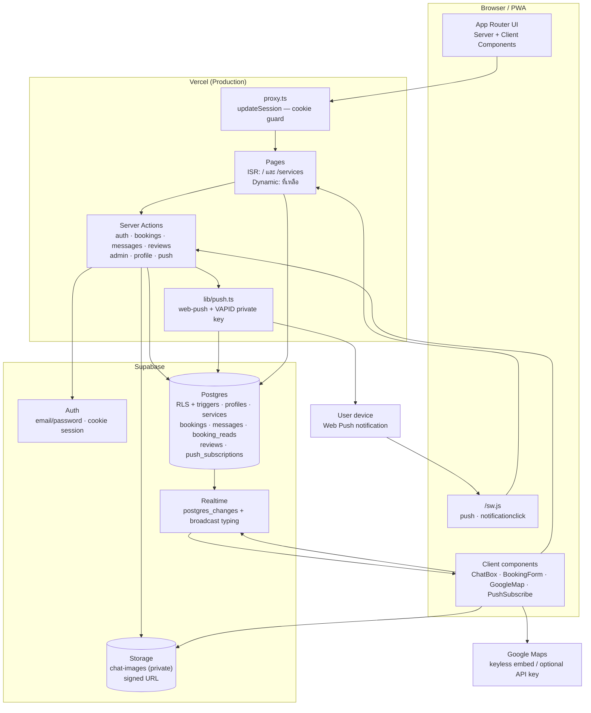
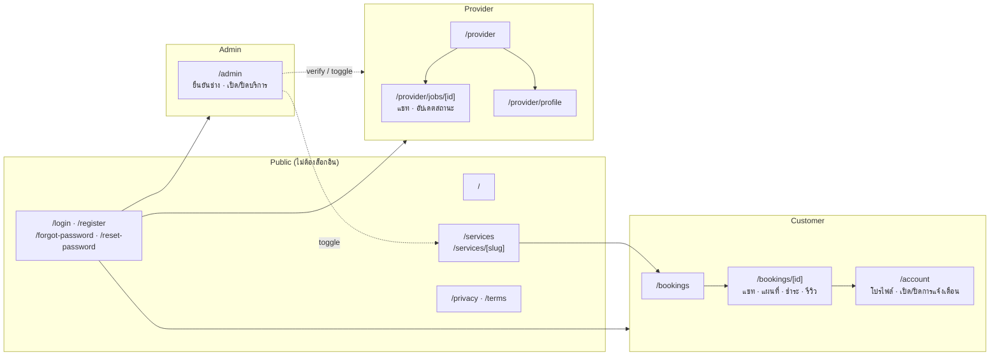
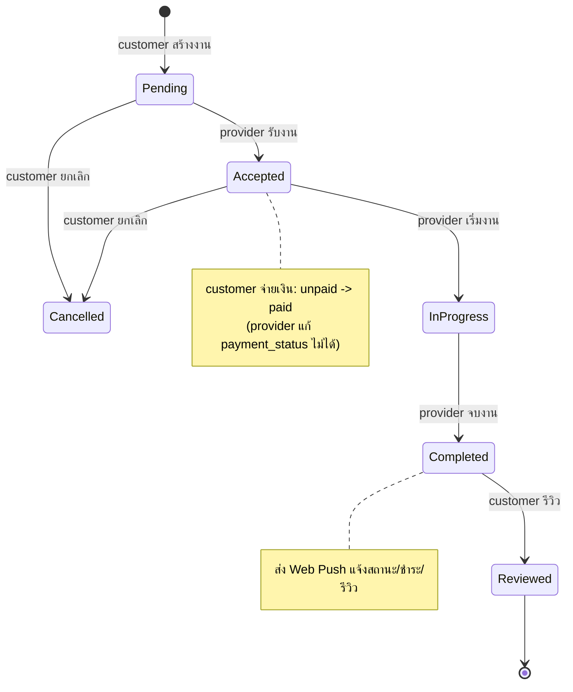
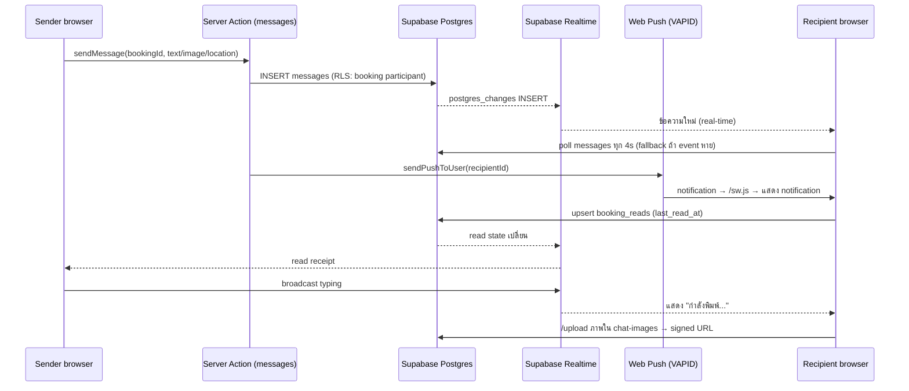
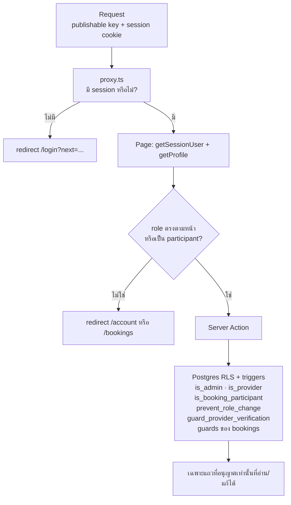

# FastHelp Web App — Diagrams

Production: `https://fasthelp-kappa.vercel.app`
Stack: Next.js 16 (App Router) on Vercel + Supabase (`oaowgicupetabfdxburr`).

> หมายเหตุความปลอดภัย: เฉพาะ **publishable key** (`NEXT_PUBLIC_SUPABASE_ANON_KEY`, `NEXT_PUBLIC_VAPID_PUBLIC_KEY`) ที่ถูกส่งถึง browser ส่วน `VAPID_PRIVATE_KEY` อยู่ฝั่ง Vercel แบบ Secret เท่านั้น

---

## 1. Architecture

---

## 2. Routes ตามบทบาท (Role-based navigation)

---

## 3. วงจรการจอง (Booking lifecycle)

---

## 4. Realtime Chat + การแจ้งเตือน

---

## 5. Security / Authorization flow

---

## 6. สรุปจุดที่ QA แล้วผ่าน

| ส่วน | ผล |
|---|---|
| Flow จอง→รับงาน→สถานะ→ชำระ→รีวิว | 29/29 |
| Realtime ข้าม user (message/read/typing) | 3/3 |
| Admin RLS + ปิดช่องโหว่ self-verify | 11/11 |
| Load test (read-only pages) | 300 VU, 0 error, p95 ~110 ms |
| Push UI + Service Worker | ปุ่มใน /account, VAPID ใน client chunk, push handler พร้อม |
